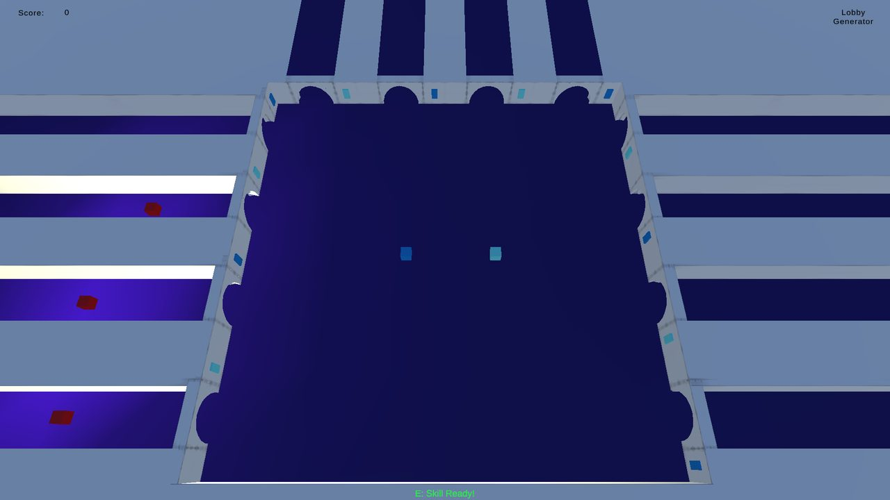
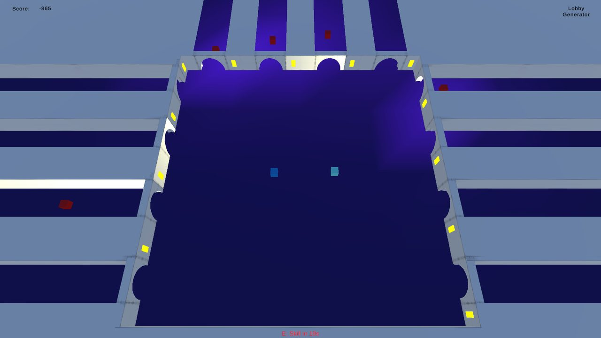
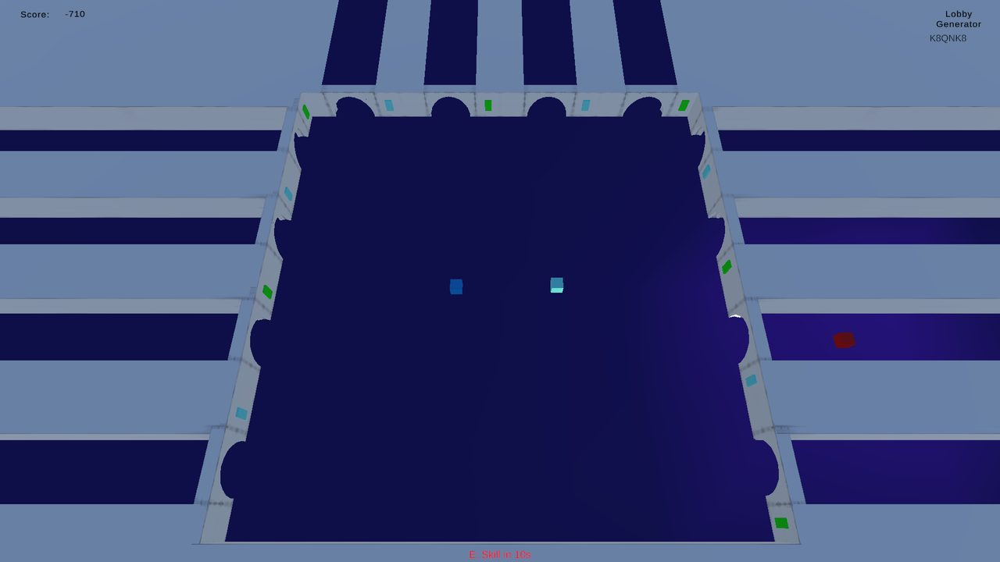

# TFG Prototype 3 · Synergy and complex strategy

Online 2-player co-op prototype built in **Unity (C#) with Netcode for GameObjects and Unity Relay**.
It is the third of three prototypes from my Final Degree Project at Universitat Pompeu Fabra (2024–2025, grade 9/10):

> _Análisis de los mecanismos en videojuegos multijugador y su impacto en la tipología de cooperación_
> (Analysis of mechanics in multiplayer video games and their impact on the type of cooperation)

The thesis analyses 44 small-scale co-op games, defines three types of cooperation (**communication**,
**planning** and **coordination**) and the mechanics that encourage each one, and validates them with
three playable prototypes and a user study with 20 participants (10 pairs).

## Download

A playable **Windows (64-bit) build** is available in the [latest release](https://github.com/Catcrac/TFG_Prototype_3/releases/latest): download `TFG_Prototype_3_Windows_x64.zip`, unzip it and run the `.exe`. One player hosts and shares the **join code**; the other enters it to join (internet connection required).

## What this prototype tests

It combines all three types of cooperation, with the emphasis on **coordination** through ability synergy.

- Enemies spawn at random through several entrances, so there is no pattern to predict.
- Next to each entrance there is a button that neutralises the enemies, but each button has a player's colour and only that player can press it. Entrances are split evenly so players can't stay together.
- Each character has a unique ability (cooldowns of 20 s and 10 s):
  - **Light blue:** turns every button into a wildcard colour that both players can press for 6 seconds.
  - **Dark blue:** activates all the buttons of their own colour at once.
- **Synergy:** if light blue turns the buttons into wildcards, dark blue's ability activates _every_ button at once.
- The level is completed at 2,500 points.

| Wildcard buttons (light blue ability) | Ability in use |
| --- | --- |
|  |  |

## Controls

| Action | Input |
| --- | --- |
| Move | WASD / arrow keys |
| Sprint | Left Shift |
| Jump | Space |
| Use ability | E |

## Running it from source

1. Open the project with **Unity 2022.3.29f1**.
2. Link it to your own Unity Gaming Services project (Edit → Project Settings → Services) and enable **Relay**: the original project ID belongs to my account.
3. Open the `Game3` scene and press Play. One player hosts and gets a **join code**; the other enters it to join.
4. To test both players on one machine, the project includes **ParrelSync** to open a clone of the editor.

## The other prototypes

- [Prototype 1 · Communication and immediate coordination](https://github.com/Catcrac/TFG_Prototype_1)
- [Prototype 2 · Planning and cooperation with the environment](https://github.com/Catcrac/TFG_Prototype_2)

## License

[MIT](LICENSE)
